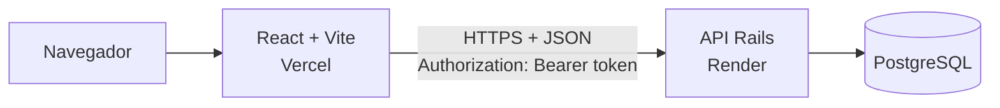
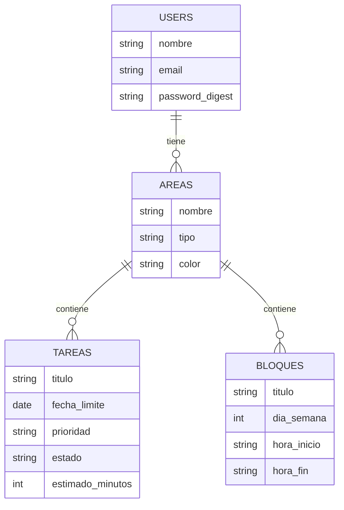

# Foco — Frontend (React)

> Organiza tu semana con foco: áreas, tareas y horario fijo en un solo lugar.

Este repositorio es el **frontend** de Foco. El backend (API REST en Ruby on Rails) está en
[`foco-api`](https://github.com/Bryan4631/foco-api).

## 1. Nombre del proyecto

**Foco** — organizador de estudios y emprendimiento.

## 2. Descripción

Aplicación web donde cada persona gestiona sus **áreas** de vida (estudio, emprendimiento,
trabajo, personal), las **tareas** de cada área (con prioridad, fecha límite y tiempo
estimado) y su **horario semanal fijo** mediante bloques por día. Incluye registro y login con
JWT, y un panel con el resumen y las próximas fechas límite.

## 3. Problema que resuelve

Quien estudia y a la vez trabaja o emprende suele repartir sus obligaciones entre varias
libretas, calendarios y apps, sin una vista única de la semana. Foco centraliza el horario fijo
(clases, turnos, trabajo propio) y las tareas pendientes, para saber qué hacer y cuándo.

## 4. Stack tecnológico

| Capa | Tecnología |
| --- | --- |
| Frontend | React 19, React Router 7, Axios, Vite |
| Backend | Ruby on Rails 8 (API REST JSON) — repo `foco-api` |
| Base de datos | PostgreSQL |
| Autenticación | JWT (Bearer token) |
| Despliegue | Vercel (front), Render (API) |
| Calidad | oxlint |

## 5. Arquitectura



Estructura del frontend (`src/`):

```
api/axios.js          Cliente HTTP único; adjunta el token a cada petición
context/AuthContext   Estado de sesión (login, logout, token en localStorage)
components/           Layout (menú lateral) e iconos reutilizables
pages/                Login, Dashboard, Areas, Tareas, Bloques
utils/format.js       Formato de fechas y horas
```

- **Rutas protegidas:** `ProtectedLayout` redirige a `/login` si no hay sesión.
- **Token centralizado:** el interceptor de Axios añade `Authorization: Bearer <token>`.
- **Errores:** una respuesta 401 cierra la sesión y lleva al login; los 422 se muestran
  campo por campo; hay estados de carga en cada pantalla.

## 6. Modelo de datos

El modelo vive en la API. Resumen:



El detalle (claves foráneas, índices, restricciones) está en el README de `foco-api`.

## 7. Instalación

Requisitos: **Node.js 20.19 o superior** y la API corriendo (local o la de producción).

```bash
git clone https://github.com/Bryan4631/foco-web.git
cd foco-web
npm install
cp .env.example .env
```

## 8. Ejecución

```bash
npm run dev       # servidor de desarrollo en http://localhost:5173
npm run build     # build de producción en dist/
npm run preview   # sirve el build localmente
```

Para usar la API local, levanta `foco-api` en `http://localhost:3000` (ver su README). Para usar
la de producción, borra `VITE_API_URL` del `.env`.

## 9. Variables de entorno

| Variable | Descripción | Ejemplo |
| --- | --- | --- |
| `VITE_API_URL` | URL base de la API. Si falta, se usa la API de producción. | `http://localhost:3000/api/v1` |

En Vercel se define en **Settings → Environment Variables**. No hay secretos en el frontend.

## 10. Tests

El frontend aún no tiene tests automatizados. Se verifica con el linter y el build:

```bash
npm run lint
npm run build
```

## 11. URL de producción

- Frontend: <https://foco-web-gamma.vercel.app>
- API: <https://foco-api-rk4y.onrender.com/api/v1>

> La API usa un plan gratuito que se "duerme" tras un rato sin uso: la primera petición puede
> tardar unos segundos.

## 12. Credenciales de prueba

| Campo | Valor |
| --- | --- |
| Correo | `demo@foco.cl` |
| Contraseña | `demo12345` |

El usuario demo viene con áreas, tareas y bloques de ejemplo (datos semilla de la API).
