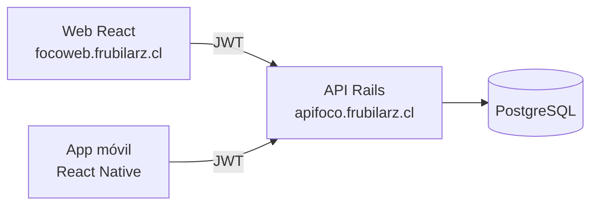

# Foco — App móvil (React Native + Expo)

Segunda interfaz del producto **Foco** (Tarea 2, Computación Web y Móvil INFO8). La app móvil
**no tiene backend propio**: consume la misma API Rails y la misma base PostgreSQL que la web
([`foco-api`](https://github.com/Bryan4631/foco-api)). La lógica de negocio y las validaciones
viven en la API; la app solo envía y muestra datos reales.



## Pantallas principales

| Pantalla | Qué hace |
| --- | --- |
| **Login** | Inicia sesión contra `POST /auth/login`; muestra errores de credenciales y de conexión |
| **Mis tareas** | Lista tareas reales (`GET /tareas`), pull-to-refresh, estado de carga y de error con reintento |
| **Detalle de tarea** | Muestra una tarea, permite **marcarla como hecha** (característica móvil), editarla o eliminarla |
| **Crear / editar tarea** | Formulario con errores 422 junto a cada campo |
| **Perfil** | Datos del usuario, su rol y cierre de sesión (revoca el token en la API) |
| **Usuarios** | **Solo administrador**: lista usuarios y cambia roles |

Flujo completo de negocio: **Login → Listado → Detalle → Crear/Editar → Confirmación (listado actualizado)**.

### Por qué estos flujos en el teléfono
Se priorizó lo que se usa en movimiento: revisar las tareas del día, marcarlas como hechas y
crear una nueva rápido. La gestión de áreas y el horario semanal quedan en la web, donde el
formulario largo y la vista de calendario son más cómodos.

## Requisitos

- Node.js 20 o superior
- Android Studio con un emulador (Android SDK) **o** un teléfono con la app *Expo Go*
- La API de Foco accesible (producción en `apifoco.frubilarz.cl`, o local)

## Instalación y ejecución

```bash
cd mobile
npm install
cp .env.example .env        # y ajusta EXPO_PUBLIC_API_URL
npx expo start              # luego: 'a' para Android, 'i' para iOS, o escanea el QR con Expo Go
```

## Variables de entorno

| Variable | Descripción |
| --- | --- |
| `EXPO_PUBLIC_API_URL` | URL base de la API, p. ej. `https://apifoco.frubilarz.cl/api/v1`. En el emulador Android con la API en tu PC: `http://10.0.2.2:3000/api/v1` |

La URL **no está escrita en el código** (`src/config.js` la lee de la variable). Tras cambiar el
`.env` hay que reiniciar `npx expo start`.

## Autenticación móvil

1. `POST /auth/login` devuelve un **JWT** (HS256, expira en 24 h) y los datos del usuario, incluido su rol.
2. El token se guarda con **`expo-secure-store`**: Keychain en iOS y Keystore en Android. No se
   usa `AsyncStorage` porque guarda en texto plano (`src/storage/tokenStorage.js`).
3. Cada petición lleva `Authorization: Bearer <token>` (interceptor de `src/services/api.js`).
4. Si la API responde **401** (token vencido o revocado), el interceptor limpia la sesión y la
   navegación vuelve sola al login.
5. Al cerrar sesión se llama `DELETE /auth/logout` (la API revoca el `jti`) y luego se borra el
   token local.

## Roles y permisos

Hay dos roles, definidos en la API: `usuario` y `admin`. **La autorización se verifica en la API**
(401 sin sesión, 403 sin permiso); la app además muestra u oculta opciones:

- La pantalla **Usuarios** y el interruptor "Ver tareas de todos" existen solo para `admin`.
- Si la API responde 403, la app muestra *"Acceso denegado: no tienes permiso para realizar esta
  acción"*, nunca un error técnico.

Matriz de permisos completa en el README de la API
([`foco-api`](https://github.com/Bryan4631/foco-api#roles-y-autorización)).

## Manejo de errores

| Situación | Comportamiento |
| --- | --- |
| Cargando datos | Indicador de carga |
| Operación exitosa | Vuelve al listado actualizado |
| 422 datos inválidos | Mensaje bajo cada campo |
| 401 | Vuelve al login |
| 403 | Mensaje de acceso denegado |
| 404 | Mensaje y regreso a una pantalla válida |
| Sin conexión / servidor caído | Aviso con botón **Reintentar** |

Toda la traducción de errores está en `src/utils/errors.js`.

## Estructura

```
mobile/
├── App.js                  navegación (React Navigation, stack)
└── src/
    ├── config.js           lee EXPO_PUBLIC_API_URL
    ├── storage/            token en SecureStore
    ├── services/           capa hacia la API (axios): api, auth, tareas, usuarios
    ├── context/            AuthContext (sesión, rol, logout)
    ├── screens/            Login, Tareas, TareaDetalle, TareaForm, Perfil, Usuarios
    ├── components/ui.js    carga, error, botón, campo de formulario
    ├── utils/errors.js     traduce errores de la API a mensajes
    └── __tests__/          tests con Jest + React Native Testing Library
```

## Tests

```bash
cd mobile
npm test
```

14 tests (Jest + React Native Testing Library): formulario de inicio de sesión, servicio que
llama a la API y traducción de errores. Los tests del backend están en `foco-api`
(`bin/rails test`).

## Usuarios de prueba

| Rol | Correo | Contraseña |
| --- | --- | --- |
| Usuario | `demo@foco.cl` | `demo12345` |
| Administrador | `admin@foco.cl` | `admin12345` |
